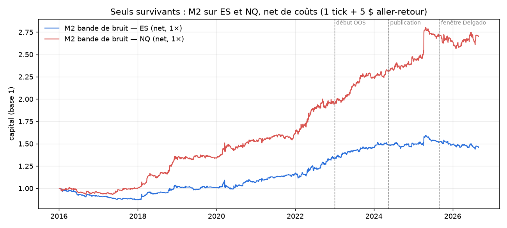

# Résultats des backtests vectorbt

*Exécuté le 2026-10-12, selon le protocole pré-enregistré [PREREGISTRATION.md](PREREGISTRATION.md) (commit `75d4a19`, antérieur à toute exécution). Les mécanismes viennent de [recherche_causalite_intraday.md](recherche_causalite_intraday.md).*

**93 tests pré-enregistrés, 2 survivants** : la bande de bruit M2 (Zarattini et al. 2024) sur **NQ** et sur **ES**. Avec 93 tests, on attend environ 5 faux positifs au seuil de 5 %. Deux survivants, c'est donc **compatible avec du bruit pur**, et seul NQ montre une stabilité qui dépasse ce que le hasard expliquerait facilement (Sharpe net de 1,15 en IS et de 1,13 en OOS sur environ 2 300 trades). Les diagnostics post-hoc plus bas nuancent ce résultat, y compris pour NQ.

Données : futures Databento 1 minute, 2016-01 à 2026-08, ajustés aux roulements. IS = 2016-2022, OOS = 2023 à 2026-08. Coût = 1 tick + 5 $ aller-retour. Exposition 1×, à plat chaque soir. Détails dans `results/summary.csv`.

## 1. Vue par mécanisme

| Mécanisme | Tests | Net > 0 en IS **et** OOS | Brut > 0 en IS et OOS | Tués par les coûts | Sharpe net médian IS / OOS | Sharpe brut médian IS / OOS |
|---|---|---|---|---|---|---|
| M1 Momentum intraday (Gao, Baltussen, Rosa, EIA) | 28 | 1 | 6 | 5 | −0,66 / −0,82 | +0,14 / −0,23 |
| M2 Bande de bruit (« Beat the Market ») | 3 | 2 | 3 | 1 | +0,62 / +0,43 | +1,00 / +0,69 |
| M3 ORB (30 min, 5 min, 30 min + volume relatif) | 27 | 6 | 16 | 10 | −0,10 / −0,02 | +0,15 / +0,33 |
| M4 Sur-réaction et reversal | 14 | 5 | 5 | 0 | +0,01 / +0,10 | +0,05 / +0,13 |
| M5 Horloge et fixings | 21 | 1 | 9 | 8 | −0,80 / −1,13 | +0,33 / +0,17 |

## 2. Ce que la recherche prédisait, et ce qu'on observe

| Mécanisme | La littérature disait | Nos données | Verdict |
|---|---|---|---|
| **M1 Momentum intraday** | Effet fondateur sur SPY (Gao 2014), mais il disparaît hors échantillon (Rosa 2022), ne tient qu'en FX sur USDJPY (Seeck 2026), et il faut un signal fort | **Négatif net partout.** Les 9 versions Gao (M1a) ont un Sharpe net négatif en IS. La version de Baltussen (M1b) est légèrement positive en IS sur NQ (+0,55) mais s'inverse en OOS (−1,10). Le filtre conditionnel (M1c) donne **le seul cas positif sur les deux périodes : 6J** (+0,31 / +0,57), exactement l'exception de Seeck. La variante EIA sur CL (M1d) est négative. | ❌ Confirme les réfutations. L'exception JPY se retrouve, mais elle est trop faible (1,3 tick net par trade). |
| **M2 Bande de bruit** | Sharpe 1,33 sur SPY 2007-2024. Échec hors échantillon après publication (Paz : 0,39 ; Delgado : −0,46 depuis septembre 2025) | **NQ : +1,15 / +1,13 net. ES : +0,62 / +0,43. YM : ≈ 0.** Sur ES, la stratégie **perd depuis la publication** (−0,16) et sur la fenêtre Delgado (−0,74), comme dans les réplications SPY. | ✅ sur NQ, ⚠️ sur ES (voir section 3) |
| **M3 ORB** | Négatif après coûts sur futures et FX (Fetna, Mahadzva, Mesfin). Le range de 5 minutes est le pire. Le filtre de volume relatif est l'ingrédient qui survit le mieux. | Brut souvent positif (16/27) mais **10 tués par les coûts**. Aucun ORB ne survit. Le filtre de volume (M3c) améliore la médiane : 6E (+0,26 / +1,09), YM (+0,13 / +0,54), mais un seul dépasse 0,5 en IS (6B, +0,51) et il tombe à +0,14 en OOS. ORB 30 min sur NQ : +0,06 en IS, puis +0,95 en OOS (régime 2023+). | ❌ Confirme Fetna. L'intuition du volume relatif est cohérente mais ne suffit pas. |
| **M4 Sur-réaction** | Indices : reversal faible face aux coûts. Pétrole et FX : inertie. Or : contrarien le lendemain. | Rien en IS (médiane +0,01). Le **fade de gap** sur indices (M4b) est ≈ 0 en IS, puis **positif sur les 3 indices en OOS** (+0,46 / +0,62 / +0,66), avec seulement environ 50 trades OOS par indice. L'inertie après une ouverture anormale (M4a) est positive en OOS sur CL et GC (+0,53 / +0,50). | ❓ Rien de robuste. Le fade de gap post-2023 rappelle le **reversal 0DTE de Ladia 2026**, mais avec ce n, c'est une piste et pas un résultat. |
| **M5 Horloge et fixings** | Mécanisme le plus causal (Krohn 2023 : profil en W autour des fixes) ; Bondarenko : le rendement d'ES se concentre autour de l'ouverture européenne | **L'effet brut existe** : fix de Tokyo post-fix sur 6J à +2,24 (IS) / +1,15 (OOS) brut, pré-fix sur 6A à +1,89 / +0,89. Long ES 01:00-05:00 ET à +0,55 / +0,65 brut. Mais **le mouvement moyen vaut 1 à 2,5 ticks, pour un coût de 1,8 à 2 ticks**. 8 tests sur 9 positifs en brut sont détruits par les coûts. | ✅ en tant qu'**effet**, ❌ en tant que **stratégie autonome** avec un coût retail. |

## 3. Diagnostics post-hoc des survivants (aucun paramètre modifié)



| Actif | Période | Sharpe net | Sharpe brut | Sharpe net, coûts × 2 | Sharpe long | Sharpe short | Rendement net |
|---|---|---|---|---|---|---|---|
| NQ | 2016-2022 (IS) | 1,15 | 1,31 | 0,98 | 0,99 | 0,68 | +95 % |
| NQ | 2023-2026 (OOS) | 1,13 | 1,20 | 1,06 | 1,01 | 0,54 | +38 % |
| NQ | post-publication (depuis 2024-05) | 0,77 | 0,82 | 0,72 | 0,50 | 0,58 | +16 % |
| NQ | fenêtre Delgado (2025-09 → 2026-08) | **0,01** | 0,06 | −0,05 | −0,26 | 0,17 | −0,2 % |
| ES | 2016-2022 (IS) | 0,62 | 1,00 | 0,24 | 0,73 | 0,25 | +34 % |
| ES | 2023-2026 (OOS) | 0,43 | 0,69 | 0,18 | 0,43 | 0,19 | +9 % |
| ES | post-publication (depuis 2024-05) | **−0,16** | 0,05 | −0,36 | −0,36 | 0,08 | −2,5 % |
| ES | fenêtre Delgado (2025-09 → 2026-08) | **−0,74** | −0,53 | −0,95 | −0,93 | −0,25 | −4,2 % |

Sharpe net par année :

| | 2016 | 2017 | 2018 | 2019 | 2020 | 2021 | 2022 | 2023 | 2024 | 2025 | 2026 |
|---|---|---|---|---|---|---|---|---|---|---|---|
| ES | −1,56 | −1,57 | 1,79 | −0,04 | 0,60 | 1,76 | 1,47 | 1,71 | 0,55 | −0,01 | −0,72 |
| NQ | −0,69 | 0,96 | 2,78 | 0,11 | 1,21 | 0,86 | 1,65 | 2,17 | 1,25 | 0,84 | 0,44 |

Lecture :
- **ES reproduit exactement les audits de 2026** (Paz, Delgado) : bon jusqu'à la publication, puis négatif. Sur ES, l'avantage tient en environ 4 ticks bruts par trade pour 1,4 tick de coût : la marge est mince (Sharpe 0,24 avec des coûts doublés).
- **NQ est plus robuste** : environ 24 ticks bruts par trade pour 2 de coût, il résiste aux coûts doublés, et les jambes longue et courte sont toutes les deux positives. Mais **avril 2025 (krach des droits de douane) apporte +10,6 %** : sans ce mois, le Sharpe OOS passe de 1,13 à 0,97. Le Sharpe est en baisse chaque année depuis 2023, et nul sur les 12 derniers mois.
- Le mécanisme se comporte comme le décrit la recherche : il gagne dans les jours de tendance à forte volatilité et s'éteint en régime calme ou de retour à la moyenne (0DTE).

## 4. Conclusions opérationnelles

1. **Une seule stratégie mérite d'être suivie : M2 sur NQ.** C'est avec réserve : 93 tests, un Sharpe en dégradation depuis 2023, une dépendance aux épisodes de crise, et un an à plat. À traiter comme un candidat à mettre en paper trading, pas comme un signal validé. Le prochain test honnête, c'est les données qui arriveront après le 2026-08-28.
2. **Le momentum intraday (M1), l'ORB (M3) et la saisonnalité des fixings (M5) ne sont pas tradables comme stratégies autonomes** avec un coût de 1 tick + 5 $. Ce résultat rejoint les réfutations pré-enregistrées de 2026 citées dans la recherche.
3. **Les effets bruts des fixings (M5c, Tokyo) sont réels et stables** mais plus petits que le spread. Ils peuvent servir de **filtre de timing d'exécution** (par exemple choisir quand exécuter un ordre FX dont on a besoin de toute façon), pas de stratégie.
4. Pistes nées de ces résultats, **à pré-enregistrer avant de les tester** (sinon elles s'ajoutent au compteur de 93) :
   - fade de gap sur indices après 2023 (cohérent avec Ladia 2026 et le régime 0DTE) ;
   - M1c sur 6J avec une exécution moins chère, par exemple des ordres limites.

## 5. Limites

- **Roulements** : la détection est automatique (ratio à 00:00 UTC, seuil 0,1 %). Les petits roulements, comme ceux de CL et du FX en faible contango, ne sont pas tous détectés. Seuls les prédicteurs « overnight » (M1, M2, M4b, M4c) peuvent en être légèrement affectés : aucune position ne traverse un roulement.
- **Coûts** : 1 tick de slippage, c'est optimiste pour des ordres stop (ORB) en marché rapide, et pessimiste pour des exécutions à l'ouverture sur ES.
- **Exposition 1× sans levier ni ciblage de volatilité**. Le papier M2 cible la volatilité : les Sharpe restent comparables, pas les rendements.
- **Le seuil de survie (0,5 / 0,3) est permissif** : il ne corrige pas les tests multiples. Un Sharpe déflaté ou un PBO reste à faire si NQ M2 passe au stade suivant.

## Reproduire

```bash
uv sync
uv run python run_backtests.py        # les 93 tests → results/summary.csv
uv run python diagnostics.py          # diagnostics post-hoc M2
```

---

# Suite : les deux pistes (pré-enregistrement n° 2)

*Protocole : [PREREGISTRATION_2.md](PREREGISTRATION_2.md), commit `7733a53`, antérieur à l'exécution. Script : `followup.py`. Sortie : `results/followup.log`. Le compteur global passe à **96 tests**.*

## Piste A : fade de gap sur les indices. **SURVIT aux 3 critères**, avec réserves

| Test | Résultat | Critère |
|---|---|---|
| A1 : gaps intermédiaires 1 < \|z\| ≤ 2, **jours jamais tradés**, portefeuille ES/NQ/YM | Sharpe net IS **−0,62**, OOS **+0,54** (ES +0,71, NQ +0,22, YM +0,43) | OOS > 0,5 ✅ |
| A2 : rupture 2023, trades poolés \|z\| > 1 | Avant 2023 : **−5,6 pb**/trade (n = 1 330). Depuis 2023 : **+8,8 pb** (n = 698). Welch t = 2,89, **p = 0,002** | p < 0,05 ✅ |
| A3 : dose-réponse depuis 2023 | \|z\| (1 ; 1,5] : +5,5 pb · (1,5 ; 2] : +6,4 pb · > 2 : **+18,3 pb** | monotone ✅ |

Descriptif post-hoc, sur le portefeuille \|z\| > 1 : Sharpe net IS −0,42, OOS **+0,79** (340 jours actifs). Par année : 2016 −1,30 · 2017 −0,87 · 2018 +0,71 · 2019 −1,33 · 2020 −1,47 · 2021 −0,66 · **2022 +0,31 · 2023 +0,70 · 2024 +0,16 · 2025 +1,33 · 2026 +0,64**. Corrélation avec M2 sur NQ : **0,01**.

Lecture :
- Le passage de la continuation (avant 2022) au **reversal** (depuis 2022) a lieu sur des jours qu'aucun test précédent n'avait tradés. Il est statistiquement net, l'effet croît avec la taille du gap, et le basculement coïncide avec la généralisation des 0DTE (mai 2022). C'est exactement la prédiction de Ladia 2026. Parmi tout ce qui a été testé, c'est **le seul résultat qui relie un signal OHLCV à un changement causal daté**.
- **Réserves** : (1) la stratégie était **perdante** sur 2016-2021. La trader, c'est parier que le régime 0DTE dure, et le jour où il change, elle se retourne. (2) Le choix de 2023 comme frontière n'a pas été optimisé : c'est la coupure IS/OOS initiale. Mais l'idée de regarder le fade de gap est venue de l'OOS. (3) La validation par nouvelles observations reste sur la **même période** 2023-2026 et sur des indices très corrélés.
- Usage raisonnable : en paper trading **avec un interrupteur de régime** (couper si le Sharpe glissant sur 12 mois redevient négatif), et en complément de M2, puisque les deux sont non corrélés.

## Piste B : M2 bande de bruit sur NQ. **REJETÉE** selon le critère pré-enregistré, verdict partagé

| Test | Résultat | Critère |
|---|---|---|
| B1 : Deflated Sharpe Ratio (N = 96) | SR 1,14 contre SR₀ attendu du meilleur de 96 essais = 1,68. Asymétrie +2,7, kurtosis 36,6. **DSR = 0,03** | > 0,95 ❌ |
| B2 : Reality Check de White (93 séries, bootstrap stationnaire) | Meilleure t-stat = 3,76 (c'est bien M2 sur NQ), **p = 0,018** | < 0,05 ✅ |
| B3 : PBO (CSCV, 12 870 combinaisons) | **PBO = 0,05**. P(Sharpe OOS < 0 pour la stratégie choisie en IS) = 0,14 | rapporté |
| B4 : Sharpe sur 2024-09 → 2026-08 | 0,81, IC 95 % = **[−0,54 ; 1,78]** | rapporté |

Lecture :
- Les deux corrections disent des choses différentes. Le **Reality Check** et la **PBO** indiquent que la sélection de M2 sur NQ n'est pas un pur artefact : le meilleur des 93 bat le hasard (p = 0,018), et choisir le meilleur en IS donne rarement un perdant OOS. Le **DSR** échoue pour deux raisons. D'abord, la dispersion des Sharpe entre les 93 essais est **gonflée par les coûts** : beaucoup de stratégies sont très négatives, ce qui élève SR₀. Ensuite, les rendements sont très asymétriques et leptokurtiques, parce que la stratégie gagne gros sur quelques jours de crise (avril 2025).
- Selon la règle fixée à l'avance (B1 **et** B2), la piste est rejetée. On ne déplace pas la barre après coup.
- Sur deux ans, l'intervalle de confiance du Sharpe contient 0 : les données récentes ne permettent ni de confirmer ni d'infirmer la stratégie.

## Bilan après 96 tests

| Candidat | Statut | Ce qui le soutient | Ce qui l'affaiblit |
|---|---|---|---|
| Fade de gap sur indices, \|z\| > 1, régime post-0DTE | Survit au pré-enregistrement n° 2 | Nouvelles observations, rupture datée, dose-réponse, mécanisme publié (Ladia) | Perdant de 2016 à 2021 ; dépend d'un régime ; 3,7 ans de preuve |
| M2 bande de bruit sur NQ | Rejeté (DSR), mais Reality Check OK | 10 ans, IS ≈ OOS, robuste aux coûts × 2 | Asymétrie de crise, plus d'avantage depuis 12 mois, DSR = 0,03 |

Aucun des deux n'est un signal validé. Les deux justifient du paper trading. Les données postérieures au 2026-08-28 constituent le seul vrai holdout restant, et il ne faudra l'ouvrir qu'une fois.

---

# Réplications fidèles (pré-enregistrement n° 3)

*Les règles viennent des textes intégraux : [PAPER_SPECS.md](PAPER_SPECS.md). Le protocole est [PREREGISTRATION_3.md](PREREGISTRATION_3.md), commit `c480de3`, antérieur à l'exécution. Code : `fab/replications.py` et `run_replications.py`. Sorties : `results/replications.csv`, `results/replications.log`. **42 nouveaux tests, compteur à 138.***

**Une survivante au filtre de base** (R3, bande de bruit avec volatilité cible sur NQ : Sharpe net +0,80 en IS, +1,07 en OOS), **rejetée par le DSR** (N = 138 : SR 0,89 contre SR₀ = 1,84, DSR = 0,000). La volatilité cible **dégrade** le résultat sur NQ (Sharpe de 0,89 sur toute la période, contre 1,14 à 1×) : elle augmente le levier dans les périodes calmes, qui sont justement celles où la stratégie ne gagne rien.

## L'effet brut est-il retrouvé ? Survit-il aux coûts ?

| Réplication | Ce que le papier annonçait | Sharpe **brut** IS / OOS | Sharpe **net** IS / OOS | Lecture |
|---|---|---|---|---|
| R1 Gao, version jointe (ES, NQ, YM) | Meilleure que η(r₁) | ≈ 0 / négatif | négatif | ❌ Effet absent depuis 2016 |
| **R2a/b Baltussen sur FX, avec la bonne session (8:20-15:00 ET)** | Momentum intraday sur les futures FX | **6E +0,81/+1,12 · 6J +0,36/+1,34 · 6B +0,59/+0,92** (ROD) ; ONFH : 6E +0,87/+1,42, 6J +0,18/+1,63 | toutes négatives | ✅ **Effet brut retrouvé, et même plus fort depuis 2023.** ❌ Mouvement moyen de 0,5 à 1,3 tick pour 1,8 tick de coût. Avec ma mauvaise session (Londres), M1 sur FX était souvent négatif même en brut : **la spécification exacte comptait**. |
| R2c Baltussen joint (9 actifs) | — | FX positif en brut ; indices et CL ≈ 0 ou négatifs | négatif | Même conclusion |
| **R3 Bande de bruit + volatilité cible** | Sharpe 1,33 (SPY 2007-2024) | NQ +0,99/+1,13 ; ES +0,96/+0,33 ; YM ≈ 0 | **NQ +0,80/+1,07** ; ES +0,54/+0,13 | ✅ sur NQ, mais DSR = 0 |
| **R4 ORB de Zarattini** (bougie de 5 minutes, objectif 10R, levier ≤ 4) | Alpha de 33 %/an, QQQ 2016-2023 | **NQ +1,16 / +0,26** ; ES +0,59 / −0,34 | **NQ +0,96 / +0,17** | ✅ **Reproduit sur sa propre période** (IS ≈ 2016-2022). ❌ S'effondre ensuite, comme dans la réplication indépendante sur MQL5. |
| R5a Krohn, Tokyo | Rendements de 6 à 14 %/an hors coûts, en baisse en fin d'échantillon | **6E +1,37 / −0,53 · 6J +1,49 / +0,28 · 6A +0,98 / +0,26** | négatif (6J IS +0,40) | ✅ en IS brut. Puis **déclin** après 2023, que les auteurs observaient déjà en 2019. |
| R5b Krohn, Europe | EUR et GBP les plus forts | 6E +0,88 / +0,09 ; 6B +0,45 / +0,51 ; 6J négatif (comme dans le papier) | négatif | ✅ partiel en brut, ❌ net |
| **R6 Breedon & Ranaldo** | **Seul EUR/USD rentable après coûts** (Sharpe 1,3 et 0,9) | **6E +1,25 / +0,57** ; 6B +0,62 / +0,75 ; 6A et 6J négatifs | **6E +0,70 / −0,07** | ✅ **Tout le schéma du papier est retrouvé** (EUR oui, JPY et AUD non), et 6E reste rentable net en IS. ❌ Plus d'avantage net depuis 2023. |
| R7a Caporale, stratégie 1 (or, pétrole) | ~70 % de trades gagnants, sans coûts | GC +0,17/+0,19 ; CL +0,18/−0,31 | ≈ pareil (environ 200 trades) | ≈ Effet faible, pas les 70 % annoncés |
| R7b Caporale, stratégie 2 | Contrarien sur l'or, momentum sur le pétrole le lendemain | GC **−0,68/−0,88** (le contrarien perd) ; CL +0,66/−0,26 | idem | ❌ Or : on observe l'inverse du papier. Pétrole : ne tient pas hors échantillon |

## Ce que la lecture des papiers a changé

1. **Les effets bruts existent.** Avec la bonne spécification, on retrouve l'effet brut annoncé pour Baltussen en FX, la bande de bruit, l'ORB de Zarattini sur sa période, Krohn sur Tokyo et Breedon & Ranaldo sur EUR/USD. Mes premiers tests en avaient sous-estimé plusieurs, faute de spécification exacte. Sur FX en particulier, la bonne session fait passer M1 d'un brut négatif à un brut de +0,8 à +1,6.
2. **Mais leur taille est d'environ 0,5 à 3 ticks par trade**, pour un coût de 1,4 à 2 ticks. Les papiers qui ignorent les coûts (Baltussen, Krohn, Caporale) ou qui supposent des coûts institutionnels (Breedon : spread EBS interbancaire) décrivent des effets **réels mais non tradables** avec 1 tick + 5 $.
3. **Plusieurs effets s'affaiblissent après leur publication** : Krohn (déjà noté par les auteurs), l'ORB de Zarattini (publié en 2023, OOS +0,17), Breedon sur EUR/USD (de +0,70 à −0,07 net), et la bande de bruit sur ES.
4. **Un résultat contredit le papier** : le contrarien sur l'or le lendemain d'un jour anormal (Caporale & Plastun) perd de l'argent sur nos données.

## Bilan global après 138 tests

| Candidat | Statut |
|---|---|
| Fade de gap sur indices (\|z\| > 1, régime post-0DTE) | Seule piste qui a passé un test pré-enregistré sur des **observations nouvelles**. Dépend du régime. |
| Bande de bruit sur NQ (1× ou avec volatilité cible) | Robuste en IS comme en OOS, mais **rejetée par le DSR** à N = 96 et à N = 138. Plus faible sur les 12 derniers mois. |
| Effets bruts FX (Baltussen avec la bonne session, Krohn sur Tokyo, Breedon sur EUR) | Réels, mais **inférieurs au coût d'un tick**. À utiliser seulement pour **choisir quand exécuter** des ordres FX nécessaires de toute façon, ou avec des coûts institutionnels. |

---

# Timing d'exécution FX (pré-enregistrement n° 4)

*Protocole : [PREREGISTRATION_4.md](PREREGISTRATION_4.md), commit `7502b53`. Script : `execution_timing.py`. Sorties : `results/execution_timing.csv` et `.log`. **12 tests, compteur à 150.** Rappel : ces effets avaient déjà été mesurés en brut, OOS compris. On estime ici leur valeur pour quelqu'un qui doit exécuter de toute façon ; ce n'est pas une découverte.*

Métrique : économie moyenne par ordre, moyennée entre un acheteur et un vendeur de la devise (ce qui neutralise la tendance), en points de base (pb) du prix, par rapport à un benchmark naïf.

| Règle | Actif | pb IS | pb OOS | Ticks | $ par M$ exécuté | t (bootstrap) | Utile ? |
|---|---|---|---|---|---|---|---|
| **X3 Baltussen** : décider entre 14:30 et 15:00 ET selon le signe de r_ROD | 6E | +0,19 | +0,24 | 0,47 | 21 | 3,06 | ✅ |
| | 6J | +0,09 | +0,32 | 0,25 | 17 | 2,14 | ✅ |
| | 6B | +0,17 | +0,20 | 0,23 | 18 | 2,22 | ✅ |
| | 6A | +0,30 | −0,01 | 0,29 | 19 | 2,02 | ❌ (OOS ≈ 0) |
| **X2 Krohn Tokyo** : acheter la devise au fix de 9:55 JST, la vendre à 15:00 JST (benchmark : TWAP 8:00-15:00 JST) | 6A | +0,89 | +0,22 | 0,93 | 66 | 2,54 | ✅ |
| | 6J | +1,02 | −0,04 | 1,18 | 66 | 2,75 | ❌ (effet disparu depuis 2023) |
| | 6E | +0,53 | −0,11 | 0,70 | 31 | 2,34 | ❌ (idem) |
| | 6B | +0,17 | −0,18 | 0,05 | 5 | 0,27 | ❌ |
| **X1 Breedon/Krohn Europe** : acheter la devise à 08:00 ET, la vendre à 16:00 ET (benchmark : TWAP 2:00-16:00 ET) | 6E | +0,66 | +0,27 | 1,11 | 52 | 1,66 | ❌ (t < 2) |
| | 6B | +0,37 | +0,80 | 0,64 | 52 | 1,37 | ❌ (t < 2) |
| | 6A | +0,16 | +0,50 | 0,36 | 28 | 0,71 | ❌ |
| | 6J | −0,11 | −0,90 | −0,61 | −39 | −1,07 | ❌ |

## Lecture

- **X3 (Baltussen) est la seule règle stable** : de 0,2 à 0,3 pb par ordre, positive en IS et en OOS sur 6E, 6J et 6B, de façon régulière depuis 2018. Elle ne demande que **30 minutes de flexibilité** sur l'heure d'exécution. Avec une correction de Bonferroni sur les 12 tests (t > 2,87), **seul 6E passe**.
- **Krohn sur Tokyo** valait 0,5 à 1 pb par ordre avant 2023 sur 6E, 6J et 6A. Il ne reste aujourd'hui que sur 6A. Le déclin observé par les auteurs se confirme.
- **X1 (Europe)** : l'économie est la plus grande en points de base (jusqu'à 0,8), mais trop bruitée pour être significative, car la fenêtre de 14 heures est très volatile.
- **Ordre de grandeur** : 0,2 pb, c'est **environ un demi-tick, soit 20 $ par million exécuté**. Pour une trésorerie qui exécute 500 M$ par an, ça fait environ 10 000 $ par an : une optimisation gratuite d'exécution, pas une source de rendement.

## Conclusion opérationnelle

Si tu exécutes régulièrement des ordres FX et que tu as une demi-heure de marge avant 15:00 ET (fin du settlement CME), applique X3. **Exécute tout de suite si le mouvement du jour va contre toi, attends 15:00 s'il va dans ton sens.** C'est gratuit, ça vaut environ un demi-tick par ordre, et c'est la seule utilisation des effets FX intraday qui tienne sur nos données. Le reste (Krohn, Breedon) a décliné, ou bien il est trop bruité pour être certain.
