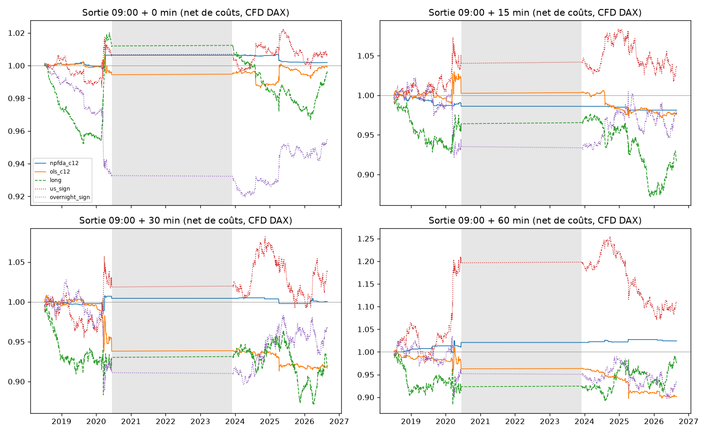

# Gap d'ouverture du DAX prédit par les courbes étrangères : rapport

*Exécuté le 2026-10-14 selon [PREREGISTRATION_5.md](../PREREGISTRATION_5.md) (commit `2df0d45`, amendements `d8895fb`, `f89c320` et `9fa50e4`, tous antérieurs à la première estimation). Inspiré de De Gooijer, Diks & Gątarek (2009), TI 2009-107/4. Code : [gap/](../gap) et [run_opening_gap.py](../run_opening_gap.py). Paramètres : [config/opening_gap.toml](../config/opening_gap.toml). Sorties : [results/opening_gap/](../results/opening_gap).*

## Verdict

**Non : le signal ne bat pas le future après coûts.**

- La configuration principale (NP-FDA, mode, Asie + US, sortie à 09:15) perd de l'argent : Sharpe net de **−0,71**, p de permutation de 0,90, DSR de 0,0002.
- Aucun des 24 candidats ne passe le DSR, même pas le meilleur. Ce meilleur, NP-FDA sur le bloc US avec sortie à 09:00, fait un Sharpe net de 0,58 et un DSR de 0,27.
- Sur la partie non tradable (A′), le gap clôture → ouverture est bien prévisible, mais **le modèle linéaire bat NP-FDA**, contrairement à l'article.

Un seul résultat statistique survit, à titre exploratoire. Le **signe** du mouvement entre 08:55 et 09:00 est prévu à environ 55 % (p = 0,0008, stable avant et après 2023). Mais l'avantage par trade est trop petit : Sharpe brut de 0,38 seulement, que les coûts ramènent à 0,13.

Aucun résultat ne déclenche le garde-fou « trop beau » (Sharpe > 3 ou taux de réussite > 70 %).

## 1. Ce qui a été testé

| | |
|---|---|
| Cible | DAX, en CFD HistData GRX/EUR (proxy validé contre le FDAX : corrélation de 0,999 sur 08:55 → 09:15, même signe 98 % des jours) |
| Asie (`c1`) | Nikkei 225, Hang Seng (tronqué à 06:50 UTC), ASX 200 : CFD HistData, 1 min |
| Amérique du Nord (`c2`) | ES et YM (futures Databento), séance 09:30-16:00 ET de la veille. Pas de TSX |
| `c12` | les deux blocs |
| Période | 2016-01 → 2026-08, **sauf 2020-06-15 → 2023-12-01** : le fichier « DAX » de HistData y contient un autre indice (amendement 3) |
| Échantillon | 2 705 séances Xetra, 1 494 retenues (jours fériés, séances écourtées, trous de données, période exclue), **994 prévisions hors échantillon** (2018-07 → 2026-08) |
| `t_decision` | 08:55 heure de Berlin. Les courbes se terminent toujours avant ; c'est vérifié à chaque prévision par l'audit anti-fuite |
| Validation | fenêtre expansive, 500 jours d'entraînement initial, réestimation tous les 20 jours ; ACP, échelle, h et coefficients réajustés sur l'entraînement seulement |
| Coûts | 1 tick + 5 € aller-retour sur le FDAX (0,7 point, environ 0,3 à 0,6 point de base), à 1× le capital, sans levier |
| Essais | 24 candidats ; compteur global : 150 → **174** |

Trois points sont apparus en route ; ils sont documentés dans les amendements.
1. **Fuseau HistData.** La FAQ annonce « EST sans heure d'été ». Les horodatages suivent en réalité les règles d'heure d'été européennes (heure brute + 7 h = `Europe/Athens`), ce qui est vérifié chaque année de 2016 à 2026. La lecture de la FAQ aurait décalé tous les étés d'une heure.
2. **Nikkei.** La Bourse de Tokyo fermait à 15:00 jusqu'en novembre 2024 : la fenêtre a été ramenée à 09:00-15:00.
3. **DAX contaminé** de mi-2020 à fin 2023 (niveaux de 3 000 à 4 400) : la période est exclue.

## 2. Variante A′ : prévoir le gap clôture → ouverture (non tradable)

y = DAX(09:00) / DAX(17:30 la veille) − 1. MSE en ×10⁻⁵. « Zéro » = toujours prévoir 0. Le test DM est unilatéral (H1 : NP-FDA bat le MCO).

| Spéc. | Période | MSE zéro | MSE MCO | MSE NP-FDA (moyenne) | p DM | Erreur de signe MCO | Erreur de signe NP (mode) | Erreur de signe NP (moyenne) | Couverture CPI 90 % |
|---|---|---|---|---|---|---|---|---|---|
| c1 | toute | 8,45 | 7,56 | 7,93 | 0,78 | 36,2 % | 41,9 % | 36,9 % | 83,5 % |
| c2 | toute | 8,45 | 7,83 | 8,11 | 0,66 | 38,9 % | 43,4 % | 37,9 % | 83,5 % |
| **c12** | toute | 8,45 | **6,10** | 7,59 | 0,99 | **30,0 %** | 40,0 % | 33,0 % | 80,5 % |
| c12 | ≤ 2022 | 10,95 | 7,29 | 9,83 | 1,00 | 25,6 % | 37,2 % | 29,2 % | 81,3 % |
| c12 | ≥ 2023 | 6,71 | 5,26 | 6,04 | 0,78 | 33,1 % | 41,8 % | 35,5 % | 79,9 % |

- **Le gap est prévisible.** Le MCO sur `c12` explique environ 28 % de la variance (6,10 contre 8,45) et donne le bon signe 70 % du temps. C'est l'effet décrit par l'article.
- **Mais il est linéaire.** NP-FDA ne bat le MCO sur aucune spécification ni aucune période. Le mode conditionnel, présenté par l'article comme le meilleur pour le signe, est ici **le pire des trois prédicteurs NP**. Critères de A′ : **non remplis.**
- **Origine de cette prévisibilité.** Chaque bloc apporte sa part : en réduction de MSE, l'Asie seule explique environ 11 %, les US seuls environ 7 %, et les deux ensemble 28 %. Dans les deux cas, l'information arrive **après** la clôture Xetra de 17:30 que la cible prend comme référence : la séance US de 15:30 à 22:00 heure de Berlin déborde après 17:30, et l'Asie cote pendant la nuit. Le DAX ne fait que la rattraper à l'ouverture. C'est exactement pour ça que A′ n'est pas tradable.
- **Les intervalles sont trop étroits.** Le CPI à 90 % ne couvre que 80 à 84 % des cas : les queues (Covid, droits de douane d'avril 2025) sont plus épaisses que ce que suggèrent les voisins.

## 3. Variante B : le résidu tradable sur le future

Entrée à 08:55, sortie à 09:00 + k. Prévision de y_k = DAX(09:00 + k) / DAX(08:55) − 1.

**Qualité de prévision (`c12`, toute la période, MSE en ×10⁻⁵) :**

| k | MSE zéro | MSE MCO | MSE NP-FDA | Erreur de signe NP (mode) | p binomial |
|---|---|---|---|---|---|
| 0 | 0,099 | 0,102 | 0,100 | **44,9 %** | **0,0008** |
| 15 | 0,674 | 0,705 | 0,684 | 50,2 % | 0,55 |
| 30 | 1,061 | 1,124 | 1,062 | 49,1 % | 0,29 |
| 60 | 1,906 | 2,020 | 1,901 | 52,8 % | 0,96 |

Aucun modèle ne fait mieux que « prévoir zéro » en MSE. Le diagnostic de la validation croisée est parlant : pour B, elle retient presque toujours la **plus grande** fenêtre h de la grille (quantiles 0,8-0,9 des distances). Autrement dit, la meilleure prévision NP-FDA est la moyenne inconditionnelle, et les courbes étrangères n'apportent rien. Pour A′, elle retient des fenêtres intermédiaires (0,2-0,6), parce qu'il y a là une structure à apprendre.

**Trading, net de coûts (Sharpe annualisé sur les 994 jours ; les jours sans position comptent pour 0) :**

| Stratégie | k = 0 | k = 15 | k = 30 | k = 60 |
|---|---|---|---|---|
| NP-FDA `c12` | +0,13 (313 trades) | **−0,71** (133) ← principale | +0,01 (62) | +0,36 (52) |
| MCO `c12` | −0,01 | −0,29 | −0,84 | −0,81 |
| Toujours acheteur | −0,05 | −0,51 | −0,39 | −0,05 |
| Signe US naïf | +0,12 | +0,24 | +0,21 | +0,42 |
| Signe nocturne du DAX | −0,73 | −0,12 | −0,14 | −0,22 |

Les 24 candidats, avec les métriques brutes, coûts × 2, drawdown, taux de réussite, rotation et exposition, sont dans [trading.csv](../results/opening_gap/trading.csv).



*Zone grise : période exclue (2020-06 → 2023-12). Le gain du « signe US naïf » à k = 60 vient presque entièrement de mars 2020.*

**Configuration principale** (NP-FDA, mode, `c12`, k = 15) :

| Critère pré-enregistré | Valeur | Seuil | |
|---|---|---|---|
| Sharpe net | −0,71 (brut −0,63) | > 0 | ❌ |
| p de permutation (1 000 tirages) | 0,90 | < 0,05 | ❌ |
| DSR, N = 24 | 0,0002 (SR₀ = 0,87) | > 0,95 | ❌ |
| DSR, N = 174 | 0,00001 (SR₀ = 1,19) | > 0,95 | ❌ |
| Bat « toujours acheteur » | oui (−1,9 % contre −8,3 %) | oui | ✅ |
| Bat le « signe US naïf » | non (−1,9 % contre +3,6 %) | oui | ❌ |

**Meilleur des 24, choisi après coup** (NP-FDA, `c2`, k = 0) : Sharpe net de 0,58, brut de 0,74, coûts × 2 de 0,41. Le p de permutation vaut 0,004, mais ce test ignore qu'on a choisi le meilleur parmi 24. Corrigé de cette sélection, le **DSR vaut 0,27 (N = 24) et 0,09 (N = 174)** : rejeté. Le résultat dépend en plus d'une année : environ 1,2 % de rendement en 2020 sur un total de 1,3 %, et +1,8 de Sharpe en 2020 contre −1,3 en 2019.

**Piste exploratoire, non tradable en l'état.** Le signe du mouvement 08:55 → 09:00 (l'enchère d'ouverture de Xetra) se prévoit à 55 % avec `c12` et `c2`, aussi bien avant qu'après 2023. Le résultat survit à une correction de Bonferroni sur les 15 tests de prévision (p corrigé d'environ 0,012). Le mouvement est loin d'être négligeable : environ 10 points de base d'écart-type sur ces 5 minutes, contre environ 0,4 point de base de coût. Le problème est ailleurs. 55 % de bons signes, sur environ 30 % des jours et avec une taille moyenne de 0,22, ne laissent qu'un Sharpe brut de 0,38, ramené à 0,13 par les coûts. Il faudrait un signal nettement plus fort, ou un coût bien plus faible (participation à l'enchère, ordres passifs), avant d'en faire une stratégie.

## 4. Validation sur le vrai FDAX (2025-03 → 2026-08, 322 jours)

Les mêmes positions, exécutées sur les prix Eurex, donnent des P&L journaliers **corrélés à 0,98-1,00** avec ceux du CFD. Le proxy ne change donc pas la conclusion. Sur cette période, NP-FDA `c12` ne trade presque plus (de 2 à 19 trades selon k), et le MCO `c12` à k = 0 fait +0,73 de Sharpe sur 261 trades, ce qui n'est pas significatif avec 322 jours. Le détail est dans [fdax_validation.csv](../results/opening_gap/fdax_validation.csv).

## 5. Découpages

Extraits de [breakdown.csv](../results/opening_gap/breakdown.csv) :
- **Principale, par année** : négative chaque année où elle trade : Sharpe de −0,2 à −2,3, et un seul trade, perdant, sur les 14 jours de décembre 2023. En 2026, elle ne trade plus du tout.
- **Principale, par régime de volatilité** : négative dans les trois terciles (−0,83, −0,83, −0,95). Le filtre de coûts devient de plus en plus bloquant à mesure que l'entraînement s'allonge, car la moyenne conditionnelle se rapproche de la moyenne inconditionnelle : 69 trades en 2019, 2 en 2025.
- **Toujours acheteur, à 15 minutes** : très dépendant de l'année (de −2,6 en 2018 à +2,1 en 2026). La fenêtre d'ouverture n'a pas de dérive stable.

## 6. Limites

- **Ce ne sont pas les données de l'article.** Le DAX et les indices asiatiques sont des CFD de courtier HistData : la provenance n'est pas documentée, les horodatages ont été corrigés par mesure, et 3,5 ans de DAX sont inutilisables. Il n'y a ni indices au comptant ni TSX, et la courbe de Hong Kong est tronquée.
- **A′ n'est qu'un proxy du gap au comptant.** La cible est calculée sur le CFD à 17:30 et 09:00, pas sur les fixings Xetra.
- **Les coûts sont ceux d'un particulier** (1 tick + 5 €). Avant 09:00, le carnet du FDAX est plus mince (volume médian de 29 lots à 08:55, contre 426 à 09:00) : le coût réel est plutôt plus élevé. Ça ne change pas la conclusion, puisque la stratégie principale perd même en brut.
- **Puissance.** Avec 994 jours, un Sharpe ne devient significatif qu'au-dessus d'environ 0,85. Un effet réel plus petit passerait inaperçu, mais il serait de toute façon trop petit pour payer les coûts.
- **Non implémenté.** La régression fonctionnelle linéaire (P-FDA, base de Fourier), prévue « optionnelle, en dernier », ne l'a pas été. Vu que le MCO sur rendements bat déjà NP-FDA en A′, elle n'aurait pas changé le verdict sur B.
- **Écart avec l'article.** Son échantillon de test faisait 35 jours en 2007-2008, ici on en a 994 sur 2018-2026. L'écart sur la non-linéarité peut venir de l'échantillon, de la période ou de nos données ; on ne peut pas trancher.

## 7. Conclusion

L'information des marchés étrangers pendant la nuit **existe** dans le gap clôture → ouverture du DAX : MCO avec R² d'environ 28 % et 70 % de bons signes. Mais elle est **linéaire**, elle vient des deux blocs (Asie et US), et **elle est déjà dans le prix du future à 08:55**. Il ne reste aucun résidu exploitable entre 08:55 et 10:00, une fois les coûts payés. La seule régularité robuste (le signe de l'enchère de 09:00) est trop petite pour les coûts d'un particulier.

## Reproduire

```bash
uv run pytest
```

```bash
uv run python run_opening_gap.py
```

Les fichiers HistData attendus dans `cache/histdata/csv/` sont décrits dans `cache/histdata/README.md` (non versionné). Le FDAX, ES et YM viennent de `D:/quant-data/Cotations`.
